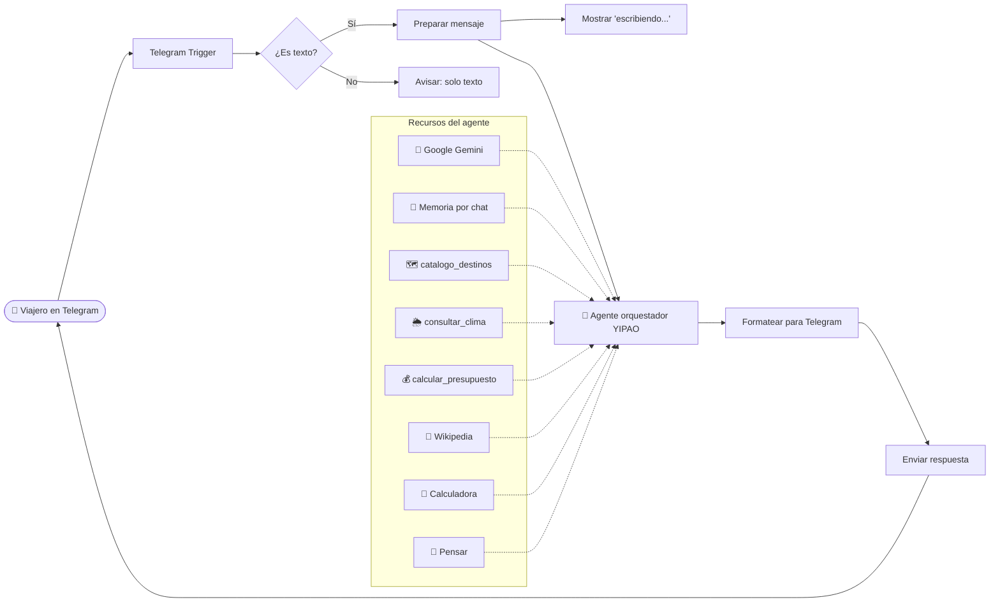

# 🚙☕ YIPAO — Agente de IA guía turístico del Eje Cafetero

**YIPAO** es un agente de inteligencia artificial construido en **n8n** que funciona como guía turístico del Quindío (Colombia) a través de **Telegram**. El viajero cuenta cuántos días tiene, con quién viaja y qué le gusta, y YIPAO le arma un itinerario personalizado con **destinos reales**, el **clima de los próximos días** y un **presupuesto estimado**.

El nombre viene de los *yipaos*, los Jeep Willys cargados que son símbolo del Paisaje Cultural Cafetero, Patrimonio de la Humanidad por la UNESCO.

> Proyecto académico — Ingeniería de Sistemas, Universidad del Quindío.


## ✨ Funcionalidades

- 🗺️ **Recomendación de destinos** según intereses: naturaleza, cultura, café, familia, aventura o gastronomía.
- 🌦️ **Clima real** de los próximos 4 días con la API de Open-Meteo; el plan se adapta al pronóstico.
- 💰 **Presupuesto estimado** por nivel (económico, medio o premium): alojamiento, comida, transporte, entradas e imprevistos.
- 💾 **Memoria por conversación**: recuerda el perfil del viajero y permite ajustar el plan ("cámbialo a económico y somos 4").
- 📖 **Preguntas de historia y cultura** respondidas con Wikipedia.
- 🌎 **Bilingüe**: responde en inglés si el turista escribe en inglés.
- ✍️ Muestra *"escribiendo..."* mientras procesa, filtra mensajes que no son texto y divide las respuestas largas.

---

## 🏗️ Arquitectura



El agente sigue el patrón **orquestador con herramientas**: recibe el mensaje, decide qué herramientas necesita y en qué orden, y redacta la respuesta final. Un plan típico encadena tres pasos. Primero busca destinos en el catálogo; luego consulta el clima con las coordenadas de esos destinos; por último calcula el presupuesto con las entradas de las actividades elegidas.

### Nodos del flujo

| Nodo | Tipo | Función |
|---|---|---|
| Telegram Trigger | Disparador | Recibe cada mensaje enviado al bot |
| ¿Es texto? | Condicional | Separa los mensajes de texto de fotos, audios o stickers |
| Avisar: solo texto | Telegram | Indica al usuario que solo se procesan mensajes de texto |
| Preparar mensaje | Set | Extrae el texto, el ID del chat y el nombre; convierte `/start` en saludo |
| Mostrar 'escribiendo...' | Telegram | Muestra la acción *typing* mientras el agente trabaja |
| YIPAO (Agente orquestador) | AI Agent | Razona, usa herramientas y arma el itinerario |
| Google Gemini | Chat Model | Modelo de lenguaje del agente |
| Memoria por chat | Simple Memory | Guarda los últimos 20 mensajes de cada conversación |
| catalogo_destinos | Code Tool (JS) | Base de datos de 12 destinos del Quindío con coordenadas, precios y tips |
| consultar_clima | HTTP Request Tool | Pronóstico real desde la API de Open-Meteo |
| calcular_presupuesto | Code Tool (JS) | Calcula el costo total y por persona según nivel |
| Wikipedia / Calculadora / Pensar | Tools | Consulta de cultura, cálculos y razonamiento previo |
| Formatear para Telegram | Code (JS) | Convierte Markdown a HTML de Telegram y divide mensajes largos |
| Enviar respuesta | Telegram | Envía la respuesta al chat del usuario |

---

## 🛠️ Tecnologías

- [n8n](https://n8n.io): orquestación del flujo y del agente de IA.
- [Google Gemini](https://ai.google.dev): modelo de lenguaje.
- [Telegram Bot API](https://core.telegram.org/bots): canal de mensajería.
- [Open-Meteo](https://open-meteo.com): pronóstico del clima (gratuita, sin API key).
- JavaScript: herramientas personalizadas y formateo de mensajes.

---

## 🚀 Cómo usarlo

### Requisitos
- Una cuenta de n8n (Cloud o self-hosted con Docker).
- Un bot de Telegram creado con [@BotFather](https://t.me/BotFather).
- Una API key de Google Gemini, desde [Google AI Studio](https://aistudio.google.com).

### Instalación
1. Descarga `workflows/yipao-telegram.json`.
2. En n8n, crea un flujo nuevo y usa **⋯ → Import from File**.
3. Crea las credenciales:
   - **Telegram API**: el token de BotFather. Asígnalo al *Telegram Trigger* y a los tres nodos de Telegram.
   - **Google Gemini (PaLM) API**: tu API key, en el nodo *Google Gemini*.
4. En el nodo *Google Gemini*, elige un modelo **Flash** disponible.
5. Guarda y **publica** el flujo.
6. Abre tu bot en Telegram y escríbele, por ejemplo: *"Tengo 2 días con mi pareja, nos gusta la naturaleza y el café, presupuesto medio"*.

> ⚠️ Con el flujo publicado, no uses el botón **Execute workflow**: cambia el webhook de Telegram al modo de prueba. Si pasa, despublica y vuelve a publicar.

### Opción con Docker (self-hosted)
```bash
docker volume create n8n_data
docker run -it --rm --name n8n -p 5678:5678 \
  -e WEBHOOK_URL=https://<tu-url-publica>/ \
  -v n8n_data:/home/node/.n8n \
  docker.n8n.io/n8nio/n8n
```
Telegram necesita una URL pública con HTTPS. Para pruebas locales puedes usar un túnel como `cloudflared tunnel --url http://localhost:5678`.

---

## 💬 Ejemplos de uso

| Mensaje | Qué hace el agente |
|---|---|
| "Tengo 3 días, vamos con niños, presupuesto económico" | Catálogo (familia) → clima → presupuesto → itinerario por días |
| "Cámbialo a premium" | Usa la memoria para ajustar el plan anterior |
| "¿Cómo va a estar el clima en Salento?" | Consulta solo el clima |
| "¿Por qué el Paisaje Cultural Cafetero es patrimonio?" | Consulta Wikipedia |
| "Hi! I have 2 days, I love coffee" | Responde en inglés |


## 📝 Notas

- Los **precios del catálogo y del presupuesto son de referencia** y deben verificarse en los canales oficiales de cada lugar.
- Las coordenadas de los destinos son aproximadas.
- El archivo `.json` no contiene credenciales; cada usuario debe configurar las suyas.

---

## 🔮 Mejoras futuras

- Integración con **WhatsApp Business** en producción.
- Catálogo en una base de datos editable (Google Sheets o Postgres) en lugar de código.
- Reservas reales con hoteles y operadores turísticos.
- Actualización automática de precios.
- Soporte para mensajes de voz (transcripción).

---

## 👩‍💻 Autora

**Emili García Bermúdez** — Estudiante de Ingeniería de Sistemas, Universidad del Quindío.

<!-- Agrega tu LinkedIn o correo si quieres -->
